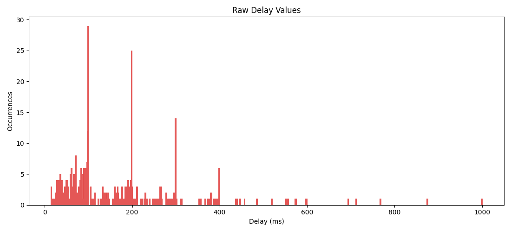
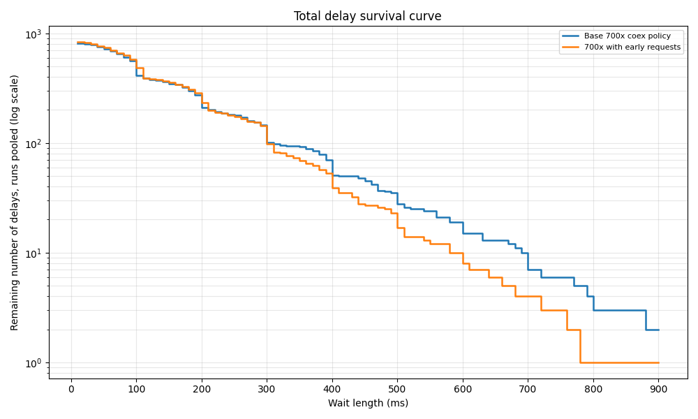

# BLE/Wi-Fi Speaker Project
This project's long-term goal is to create a Wi-Fi speaker hub connected to a primary battery-powered BLE peripheral that is the user interface to an IoT network of small BLE antennas/radar sensors. The goal is for the Wi-Fi hub to control a speaker system with head tracking/spatial audio informed with the BLE antenna network.

Starting from first principles in a communications perspective, minimizing latency and maximizing throughput are of particular importance, especially with the data and fidelity requirements for head tracking and spatial audio. My goal is to have a maximum latency of 200 ms, i.e. 2 missed connection intervals (100ms each).

## Core goals
- Improve on link-layer procedures (ex: coexistence, packet timings, 802.11 info)
- Set up working speaker configuration (audio beamsteering/focusing) and IoT peripherals

## Current Status
Obtained existing nRF 700x arbitration policy differences on local setup:

(Wi-Fi 802.11n in 2.4GHz, separate antennas)
| Test Case | Wi-Fi UDP TX throughput in Mbps | Bluetooth LE throughput in kbps |
|---|---|---|
| Wi-Fi only, client (UDP TX) | 8.30 | N.A.|
| Bluetooth LE-only, central | N.A. | 1377 |
| Wi-Fi and Bluetooth LE, coexistence disabled | 7.46 | 498 |
| Wi-Fi and Bluetooth LE, coexistence enabled | 6.47 | 634 |

Found that ~99% of all radio requests get access in < 10 ms, however the outliers take up between 66-73% of all delayed time. Outliers are discretized around connection interval timings, as denied anchors stall until the next interval:

(example timings from existing arbitration policy)

When transmitting UDP Wi-Fi packets, more delays will occur if BLE requests only set the request wire high for a short duration before they read the grant wire. A possible conclusion is that fewer delays will occur if the request wire is pulled high for longer before the grant wire is read (as UDP packets have many spaces between for the PTA to read the request wire). To realize this, a lever I can pull for this is a callback from the MPSL, pulling request high early for the first Tx anchor request, between 200 and 5500 us before the radio event. However, this is only done after two missed connection intervals to avoid starving Wi-Fi during the common < 10 ms connection event case.

(early request vs normal request delays, 1000 us lead time; pooled runs)

After 3 missed intervals (300 ms), the number of remaining delays decreases faster than the base 700x case, and there are reduced stall outliers. This is at a minor tradeoff of some Wi-Fi throughput by virtue of the radio giving more time to stalled BLE connections:

(Wi-Fi 802.11n in 2.4GHz, separate antennas)
| Test Case | Wi-Fi UDP TX throughput in Mbps | Bluetooth LE throughput in kbps |
|---|---|---|
| base 700x coex policy | 6.21 | 419 |
| 700x coex policy with early requests | 6.05 | 445 |

| Waits ≥ X ms | base 700x coex policy | 700x with early requests | % change |
|---|---|---|---|
| 350 ms | 92 | 69 | -25% |
| 450 ms | 45 | 27 | -40% |
| 550 ms | 24 | 12 | -50% |

(Note variable baselines due to different measurement windows, however relative baselines and tested policies are taken within 5 minutes. These two tables should be read independent of the table at the start of the Current Status section.)

This policy change is in `ble_coex/other_edits/mpsl_cx_nrf700x.c`, which corresponds to `nrf/subsys/mpsl/cx/nrf700x/mpsl_cx_nrf700x.c` (copied over due to git formatting constraints). The plots were generated with `docs/data/delay_plotter.py`.

## Next Steps
- Measure tradeoff with a high request wire after 1 missed connection interval (2 is the minimum with the current code since we are setting it during connection intervals themselves); this is because with the current 2 interval wait before requests, delays start decreasing from baseline after the 3rd interval. moving it earlier may help with this
- Wi-Fi transmission side logic: timing low-priority requests with known BLE intervals, leverage timing with this project's Wi-Fi radio usage compared to the testing's constant UDP stream
- Use the nRF52840 sniffer to identify link-layer events that are sent with high priority
- Get longer/more build runs for less variance

## Hardware
Note that the final project will have the peripheral and central swapped as noted below in this table, compared to the ble_coex build which has the 7002 as the central and the 5340 as the peripheral.
| Device | Role |
|---|---|
| nRF7002 DK | BLE peripheral/GATT server, WiFi client with MacBook server|
| nRF5340 DK | BLE central/GATT client |
| nRF52840 Dongle | BLE sniffer |
| MacBook | Wi-Fi server |

See `docs/notes.md` for a full history of the project's status.